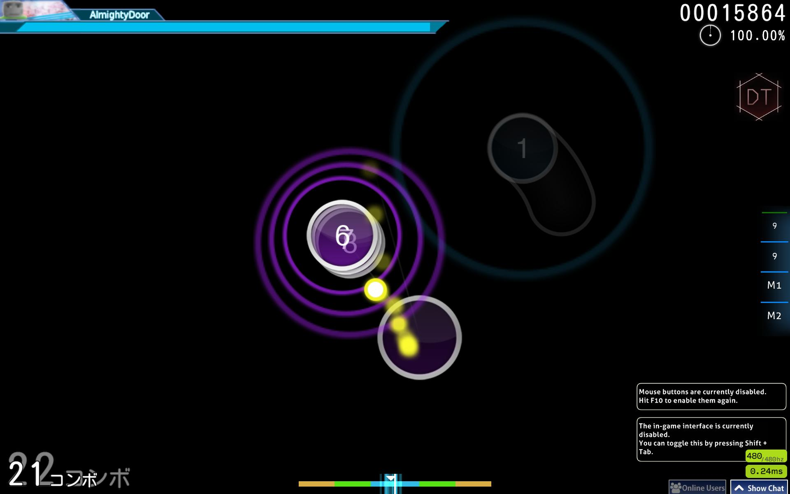
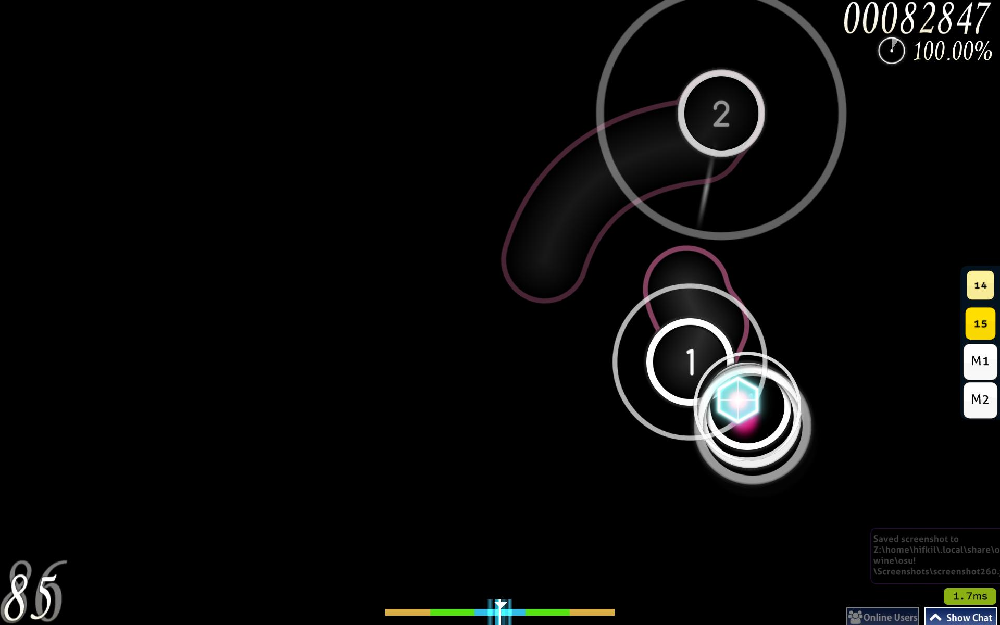
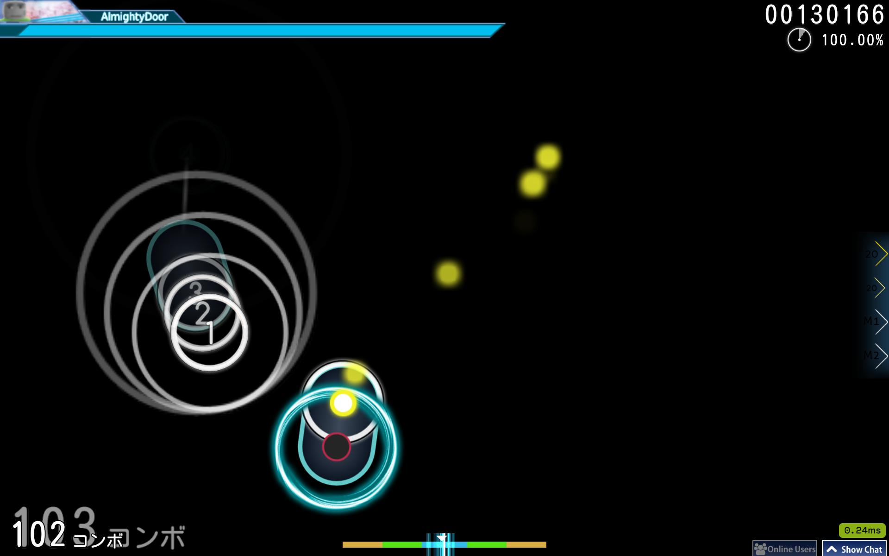
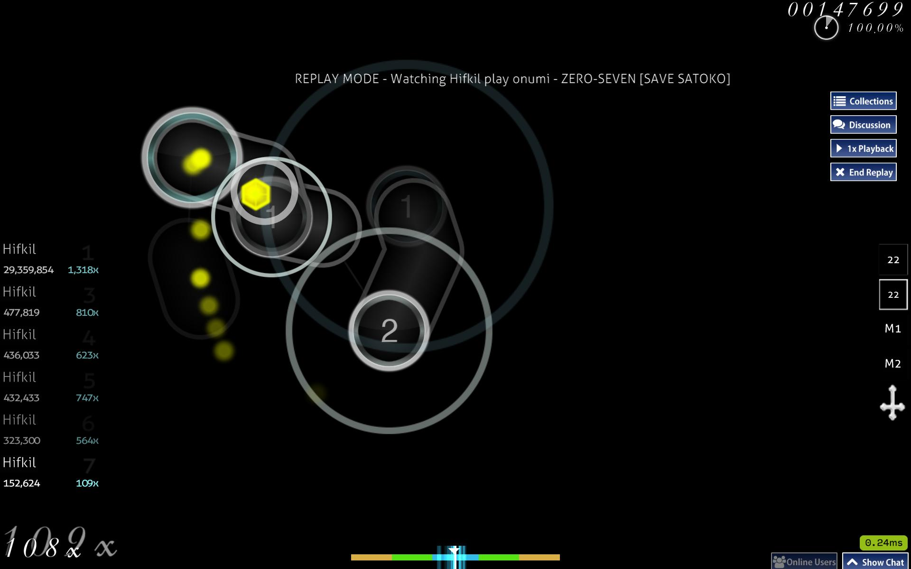
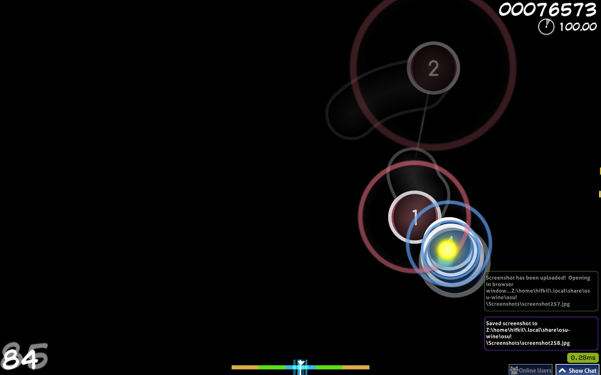

# Hifkil skin list
All the osu! skins I may use.

**How to install:** download the `.osk` file and double-click it (or drag it onto the osu! window), and osu! will import it.

## Aristia(EDIT) + AlmightyDoor
goated hitsound nothing special

**[⬇️ Download Aristia(EDIT) + AlmightyDoor](https://github.com/Hifkil/myskins/raw/main/skins/Aristia%28Edit%29%2BAlmightyDoor.osk)**

## DT.4

**[⬇️ Download DT.4](https://github.com/Hifkil/myskins/raw/main/skins/dt.4.osk)**

## Rafis 2017-08-10 + AlmightyDoor

**[⬇️ Download Rafis 2017-08-10 + AlmightyDoor](https://github.com/Hifkil/myskins/raw/main/skins/Rafis%202017-08-10%2BAlmightyDoor.osk)**

## Stellerino

**[⬇️ Download Stellerino](https://github.com/Hifkil/myskins/raw/main/skins/stellerino.osk)**

## Tekkito iEtherial

**[⬇️ Download Tekkito iEtherial](https://github.com/Hifkil/myskins/raw/main/skins/tekkito_ietherial.osk)**

---
